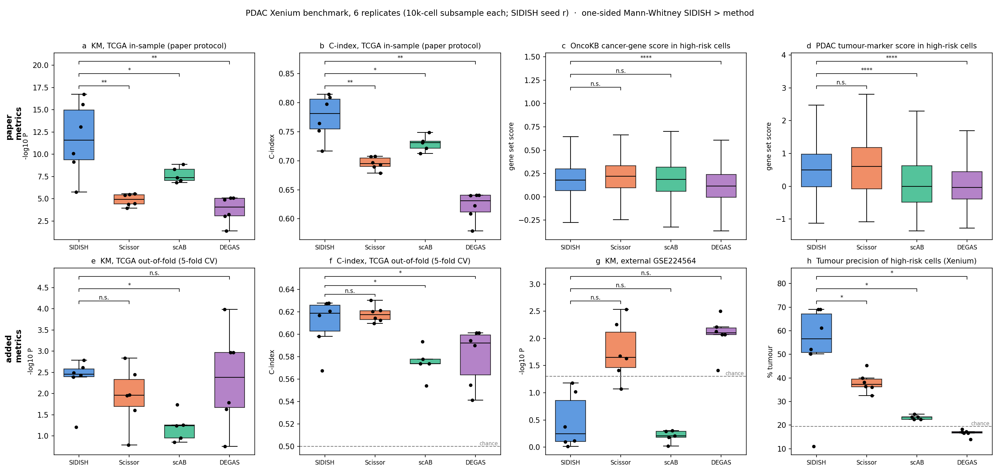

# SIDISH on spatial transcriptomics: reproduction and benchmark

Reproduction and extension of **SIDISH** (Jolasun et al., *Nature Communications* 16:11271, 2025) on 10x Xenium data, using the COVET spatial extension in [`../SIDISH`](../SIDISH).

Author: Shrey Mehta · Last updated: October 2026

---

## Headline results

### 1. PDAC: the paper's spatial result reproduces, and ensembling stabilises it

Tumour precision is the share of SIDISH "high-risk" cells that are annotated tumour cells. Chance is 19.65%.

| | Tumour precision | AUROC |
|---|---|---|
| Paper (Fig. 5) | 67.5% | — |
| Single full-pipeline runs, 6 seeds | 11.8 – 67.7% (median 57.8%) | 0.55 – 0.92 |
| **Rank-average of all 6 runs** | **66.8%** | **0.906** |
| Worst possible 5-run ensemble | 60.1% | — |

About 98% of the single-run variance comes from which patients land in the bulk train/test split, not from weight initialisation. Averaging several full runs removes it. Frozen-trunk experiments underestimate the full pipeline (22.3% vs 52.7% mean), so they should not be used to judge it.

### 2. Paper Fig. 6 / 7 reproduced against Scissor, scAB and DEGAS (PDAC, 6 replicates)



| Median | SIDISH | Scissor | scAB | DEGAS | Bulk-only Cox |
|---|---|---|---|---|---|
| Tumour precision (10k-cell subsamples) | **56.6%** | 37.3% | 23.4% | 16.9% | — |
| Tumour AUROC | **0.87** | 0.54 | 0.57 | 0.48 | — |
| C-index, in-sample (paper protocol) | 0.78 | 0.70 | 0.73 | 0.63 | **0.85** |
| C-index, 5-fold CV | 0.619 | 0.617 | 0.574 | 0.592 | **0.657** |
| KM −log10 P, external GSE224564 | 0.25 | 1.65 | 0.21 | **2.10** | 2.02 |

- **SIDISH wins** at locating tumour cells. Only spatial ground truth can measure this, and the paper does not report it.
- **SIDISH wins on in-sample survival**, which is the paper's own protocol.
- **SIDISH ties or loses on every held-out survival test.** Plain bulk-only Cox markers beat it, which contradicts the paper's Fig. 7a–e.
- **Survival guidance does not improve the embedding.** ARI is 0.280 for SIDISH and 0.278 for the plain VAE, which contradicts Fig. 7f–j.

### 3. Why SIDISH works on PDAC but not on BRCA or LUAD

SIDISH only sees survival through a Cox head trained on bulk patients. Cells come out "high-risk" only when bulk survival is carried by a programme that tumour cells express.

| Dataset | What drives bulk survival | Result |
|---|---|---|
| PDAC | Tumour and proliferation genes (MKI67, TOP2A, CDK1, KRT7, MET), risk-increasing | Works (lift ~3.4×) |
| BRCA (HER2+ section) | Lymphoid genes, protective and weak (0 FDR-significant genes) | Below chance |
| LUAD (Xenium 5K) | Angiogenic and myeloid programmes; cell-type mix explains 98.6% of between-patient variance | Below chance (13.54%); tumour depleted 0.47× |

**LUAD neighbourhood check** (best run, high-risk vs other cells of the same type; [`report/figs/luad_highrisk/`](report/figs/luad_highrisk)):

| Cell type | Share of high-risk cells | Median distance to tumour, high-risk vs others |
|---|---|---|
| Endothelial | 31% | 188 vs 191 µm (no difference) |
| Alveolar epithelial | 19% | 235 vs 224 µm |
| Fibroblasts | 12% | **25 vs 147 µm** (cancer-associated: POSTN, FAP, COL11A1) |
| Macrophages | 11% | 43 vs 33 µm (farther) |

Only the high-risk fibroblasts sit at the tumour border. The vessel and macrophage calls are normal lung tissue. In PDAC, by contrast, high-risk macrophages, fibroblasts, endothelium and T cells all sit 2–5× closer to tumour than their low-risk counterparts (ductal cells are the exception) ([`analysis/risk_proximity.py`](analysis/risk_proximity.py)).

### 4. Paper-level findings

- **LUAD external validation does not reproduce.** The paper's own 212 marker genes give P = 0.50 and 0.49 on its two cohorts; the paper reports 1e-19 and 1e-21.
- **One of the two "LUAD" cohorts is squamous carcinoma.** All 249 samples of GSE157009 are squamous.

Full write-ups: [`report/RESULTS.md`](report/RESULTS.md) (results and figures) and [`report/MECHANISM_AND_ROADMAP.md`](report/MECHANISM_AND_ROADMAP.md) (mechanism, next steps, publication plan).

---

## Layout

```
benchmark/
├── run_pdac.py               full SIDISH pipeline, one seed (PDAC_SEED=1 python run_pdac.py pdac_seed1)
├── fig6_pdac/                paper Fig 6: SIDISH vs Scissor / scAB / DEGAS
│   ├── prep.py               6 random 10k-cell subsamples + bulk inputs for the R tools
│   ├── run_tools.R           one tool on one replicate, published defaults
│   ├── run_tools.sh          all tools × replicates, resumable
│   ├── score.py              KM, C-index (in-sample, CV), external cohort, tumour precision / AUROC
│   ├── plot.py
│   └── metrics.csv, geneset_scores.csv, markers.json, *.png   results
├── fig7_pdac/                paper Fig 7: bulk-only markers, plain-VAE embedding
│   ├── train_plain_vae.py    SIDISH phase 1 only, no survival
│   ├── score7.py
│   ├── run_fig7.sh
│   └── bulk_vs_sidish.csv, embedding_metrics.csv, fig7_pdac.png   results
├── analysis/
│   ├── gene_survival.py      per-gene Cox on bulk + which cell type expresses each gene
│   └── risk_proximity.py     are high-risk non-tumour cells closer to tumour than their own type?
└── report/
    ├── RESULTS.md, MECHANISM_AND_ROADMAP.md
    ├── make_figs.py, fix_figs.py, fix_fig6.py
    └── figs/                 all figures, incl. luad_highrisk/
```

## Running

All scripts run from `benchmark/` and import the package from the repo root. Data is not in the repo; see [`DATA_SETUP.md`](DATA_SETUP.md).

```bash
cd benchmark
pip install -r requirements.txt

# SIDISH full pipeline, one seed (~10 h on CPU)
PDAC_SEED=1 python run_pdac.py pdac_seed1

# Fig 6 benchmark (R env with Scissor, scAB, DEGAS; DEGAS also needs TensorFlow)
python fig6_pdac/prep.py
RSCRIPT=/path/to/Rscript DEGAS_PYTHON=/path/to/python bash fig6_pdac/run_tools.sh
python fig6_pdac/score.py && python fig6_pdac/plot.py

# Fig 7 ablations
bash fig7_pdac/run_fig7.sh

# Neighbourhood check on any run
python analysis/risk_proximity.py --adata <run>/adata_SIDISH.h5ad --celltype-col celltype_major \
    --tumour "Tumor Cells" "CFTR- Tumor Cells" --highrisk-col SIDISH --highrisk-value h
```

## Caveats

- The Fig. 6/7 comparison uses the 474-gene Xenium panel and 10k-cell subsamples, not the paper's full-transcriptome scRNA-seq. Compare rankings, not absolute values.
- scAB has 5 of 6 replicates; replicate 1 exceeded the time cap.
- SIDISH seed 1 collapses (11% precision) and drives most of the "ahead but not significant" results.
- The paper does not state its marker-scoring rule. We used mean z-score, median split and log-rank.
