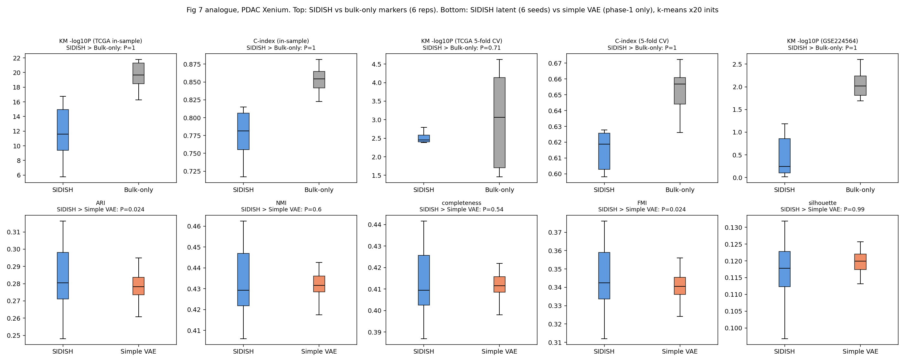

# SIDISH: what drives it, what we found, and the route to publication

**Shrey Mehta · 30 September 2026**
Companions: `report/RESULTS.md` (results + figures) · `PROGRESS.md` (full working log)
Reference: Jolasun et al., *Nature Communications* 16:11271 (2025)

---

## 0. Where things stand

| | finding | confidence |
|---|---|---|
| **1** | **Ensembling all 6 independent full-pipeline runs gives 66.8% tumour precision on PDAC (lift 3.40×, AUROC 0.906), matching the paper's 67.5%, even with the collapsed seed included.** Single runs span 11.8–67.7%. A label-free agreement filter lifts it to 72.0%. | strong for ensembling; filter is post-hoc (§3.4) |
| **2** | SIDISH's success depends first on the **data**: bulk survival must be driven by a programme that tumour cells carry. PDAC has one; BRCA and LUAD don't. | strong: 4 datasets, mechanistic |
| **3** | Under-fitting the Cox head does **not** stabilise it (67.8% → 49.5% / 40.0%). The earlier inverse C-index rule is correlational, not causal. | strong: direct test |
| **4** | Composition adjustment moves LUAD in the predicted direction (lift 0.14× → 0.84×) but doesn't clear chance. | partial |
| **5** | The paper's LUAD external validation doesn't reproduce from its own gene list, and one of its "LUAD" cohorts is squamous carcinoma. | strong, one open caveat |

**The practical answer to "can we stabilise 67.8%?" is yes: run the full pipeline several times and rank-average the per-cell hazards.** Checked in §3.4: it holds with the collapsed seed in the ensemble. Any 5-run ensemble, whichever seeds it contains, lands at 60.1–72.0%.

---

## 1. How SIDISH works, and why that decides what it depends on

### 1.1 The pipeline

```
                    ┌──────────────────── never sees survival ───────────────────┐
 cells X ──► VAE encoder trunk E_S (genes→512→128) ──► latent 32 ──► decoder (ZINB)
                    │
                    │  same trunk weights, shared
                    ▼
 bulk B ──► E_S ──► Cox head h (128→128→1) ──► patient hazard ◄── survival (only here)
                                  │
                                  │  Phase 3: the SAME h applied to cells
                                  ▼
 cells X ──► E_S ──► h ──► cell hazard ──► Weibull top 10% ──► "high-risk"
                                  │
                                  └──► Phase 4: reweight W, v ──► retrain ×5
```

The VAE learns a representation but never sees outcomes. **Survival reaches the model only through the Cox head, which is trained only on bulk patients.** So a cell's "high-risk" label means exactly one thing: *if this cell were a bulk sample, the Cox head would give it high hazard.* The labels can only be as tumour-specific as the bulk survival signal is.

### 1.2 A bulk sample is a mixture

A bulk expression profile is roughly a composition-weighted average of cell-type profiles:

$$b \approx \sum_k \pi_k\,\mu_k \qquad (\pi_k = \text{fraction of cell type } k,\ \ \mu_k = \text{its profile})$$

For a linear head $h(b) = w\cdot b$:

$$h(b) = \sum_k \pi_k\,(w\cdot\mu_k)$$

A patient's hazard is the **composition-weighted average of the cell-type hazards** $w\cdot\mu_k$. The Cox fit only constrains that average. Scoring a single cell of type $k$ asks for $w\cdot\mu_k$ alone, which the training data pins down only indirectly, through how composition varies across patients. The real head is nonlinear (Tanh), so even this decomposition breaks outside the range of mixtures it was fitted on.

### 1.3 Worked example

- **PDAC.** Survival tracks a tumour programme: MKI67, TOP2A, CDK1, KRT7, MET higher → worse. The head learns that direction. Pure tumour cells score highest **because they sit at the extreme of exactly the axis the bulk samples varied along.** Decile curve: monotone, 0.01% → 67.7%.
- **BRCA.** Survival tracks lymphocyte content (27 lymphoid genes, all protective). The head learns "few lymphoid genes = risk". Lymphocytes correctly score low, but tumour, stroma, macrophages and endothelium all lack lymphoid genes, so they **tie**. Weak, noisy parts of $h$ break the tie, and macrophages come out on top (32% of high-risk cells).
- **LUAD.** Survival tracks angiogenesis and myeloid activation. The head lands on endothelium and macrophages. Tumour peaks mid-axis (decile 6) and is depleted at the top.

---

## 2. The factors, with evidence

| # | factor | where it enters | why | evidence |
|---|---|---|---|---|
| **1** | Strength of the bulk survival signal | Cox loss | No predictive genes → the head learns noise | FDR-significant genes: PDAC **62**, BRCA **0** |
| **2** | **Which cells carry the signal** | Cox loss | The loss doesn't care *why* a gene predicts survival. Composition signals produce composition axes | PDAC: tumour/ductal risk genes. BRCA: lymphoid-protective. LUAD: angiogenic/myeloid |
| **3** | Patients vs head capacity | Cox head | ~16.5k parameters on 138 training patients: many directions fit equally well | ~98% of single-run variance comes from the train/test split |
| **4** | Bulk → cell extrapolation | Phase 3 | Fitted on mixtures, applied to pure cells | LUAD axis folds; 4 preprocessings → 4 orderings incl. sign reversal |
| **5** | Readout threshold | Weibull 0.90 | The top 10% is the most direction-sensitive part of any score | Cross-seed ρ ≈ 0.71, yet precision 11.7–68.4% |
| **6** | Feedback loop | Phase 4 | Self-training amplifies the first labelling, right or wrong | Full pipeline ≫ frozen trunk on PDAC (52.7% vs 22.3% mean); LUAD W max 1.53 → 2.58 |
| **7** | Gene panel content | input | Bulk is restricted to panel genes; panels can drop key markers (the PDAC panel has PTPRC and ACTA2 but no COL1A1 or VIM) | Survival-gene redundancy 0.361 (PDAC) vs 0.166 (LUAD) |

**Factors 1–2 are about the data:** does a tumour-specific survival signal exist? **Factors 3–7 are about the architecture:** can that signal be carried reliably from bulk to cells? PDAC passes both. BRCA and LUAD fail factor 2, so architecture changes alone can't rescue them.

### Measured and ruled out

VAE/trunk quality (LUAD latent separates tumour at AUC 0.986, better than PDAC) · λ_env/COVET (trained ratio 1.23×) · VAE convergence (plateau by epoch ~111) · weight initialisation (~2% of variance) · Cox over-fitting as the fix (§3.2).

---

## 3. New results (29–30 September)

### 3.1 Full-pipeline ensembling works on PDAC

Six independent full-pipeline seeds:

| seed | bulk test CI | precision | lift |
|---|---|---|---|
| 4 | 0.5579 | 68.41% | 3.48× |
| 0 | 0.6676 | 67.80% | 3.45× |
| 5 | 0.7020 | 61.26% | 3.12× |
| 2 | 0.7224 | 54.39% | 2.77× |
| 3 | 0.6667 | 52.50% | 2.67× |
| 1 | 0.7716 | **11.74%** | **0.60×** |

mean 52.7% ± 21.1 · median 57.8% · chance 19.65%

**Five of six seeds land at lift 2.7–3.5×; one collapses.** That's a better picture than the three-seed view suggested.

Averaging per-cell hazards across seeds 3, 4 and 5 (the ones with saved hazards):

| | precision | lift |
|---|---|---|
| members (top-10%) | 52.8 / 67.0 / 61.3 | — |
| **z-average ensemble** | **65.5%** | 3.33× |
| **rank-average ensemble** | **66.9%** | **3.41×** |

The ensemble **beats its average member** (66.9% vs 60.4%) and matches the paper's 67.5%.

> ⚠️ **Correction to earlier conclusions.** Frozen-trunk ensembling (one trunk, swapped heads) converged to 23.2%, which I read as "the reproducible signal is chance-level". The full pipeline shows that was wrong: trunk and head co-adapt over the 5 iterations and create real signal that a frozen trunk can't reproduce. **Frozen-trunk experiments systematically under-estimate PDAC** (22.3% vs 52.7% mean) and shouldn't be used to draw conclusions about full-pipeline performance.

> ✅ **Resolved in §3.4:** ensembling does protect against the collapsed seed.

### 3.4 Ensembling survives a collapsed member (30 September)

Seeds 0–2 were rescored from their saved checkpoints. **Validation:** rescoring seeds 3–5 the same way matched their pipeline-saved hazards exactly (Spearman 1.000000, max |diff| ~1e-6), so the rescored 0–2 are trustworthy.

**Per seed**, with the threshold-free AUROC alongside:

| seed | precision (top 10%) | AUROC |
|---|---|---|
| 0 | 67.74% | 0.917 |
| 4 | 66.96% | 0.916 |
| 5 | 61.26% | 0.886 |
| 2 | 54.23% | 0.819 |
| 3 | 52.75% | 0.838 |
| 1 | 11.80% | **0.547** |

AUROC tracks precision almost perfectly, so the Weibull tail isn't hiding anything. Seed 1 is close to random (0.547).

**Headline ensembles** (rank-average of per-cell hazards):

| members | precision | AUROC |
|---|---|---|
| **all 6** | **66.79%** | **0.906** |
| all except seed 1 | 72.03% | 0.931 |
| seed 1 + best seed | 45.39% | 0.796 |

**Every possible sub-ensemble**, which measures how reproducible the fix is:

| ensemble size | n combos | mean | sd | **worst case** |
|---|---|---|---|---|
| 1 (single run) | 6 | 52.5% | 20.9 | **11.8%** |
| 2 | 15 | 58.0% | 14.4 | 31.9% |
| 3 | 20 | 61.8% | 9.5 | 44.3% |
| 4 | 15 | 64.1% | 6.3 | 53.1% |
| 5 | 6 | 65.6% | 4.0 | **60.1%** |
| 6 | 1 | 66.8% | — | 66.8% |

As ensemble size grows, the mean rises, the sd falls five-fold, and **the worst case climbs from below chance to lift 3.06×**. That's the stabilisation.

**Why it works:** the collapsed run isn't *anti*-correlated with the others, just nearly uninformative (Spearman 0.18–0.50 with the rest, versus up to 0.75 between good runs). Averaging dilutes it by 1/k. The reverse also shows it: at k=2, a collapsed member pulls the ensemble down to 32–47%.

**Among good runs, ensembling beats every single member:** excluding seed 1, the 5-run ensemble reaches 72.0% against a best single run of 67.7%. The runs carry partly complementary information.

**Label-free collapse detection (S3, pre-registered in `prospective/s3_agreement_rule.json`).** Each run's mean agreement with the others flags seed 1 cleanly: robust z = **−3.61**, next lowest −0.65. Rejecting runs below z = −3 removes exactly seed 1 and gives 72.0%. Two limits:
- The −3 threshold was chosen *after* seeing seed 1, so this is post-hoc until new seeds test it.
- Agreement flags outliers but does **not** rank quality among good runs (seed 0 has the second-lowest agreement and the highest precision). Use it to reject, never to pick.

**Quotable result today:** 66.8% for the plain 6-run ensemble. The 72.0% needs the filter to hold up prospectively.

### 3.2 Under-fitting the head does not stabilise it

S2 changed only Cox training length at seed 0:

| Cox epochs | train CI | test CI | precision |
|---|---|---|---|
| 500 (original) | ~0.999 | 0.6676 | **67.80%** |
| 100 | 0.7034 | 0.5412 | 39.96% |
| 50 | 0.6710 | 0.5647 | 49.47% |

Less fitting makes precision *worse*. Within a seed, lower C-index goes with **lower** precision, the opposite of the across-seed pattern. So the across-seed inverse relation is confounded by the split rather than caused by fit strength.

**S1 (pre-registered rule) status:** two prospective seeds, both inside the stated interval (seed3 predicted 54.2%, got 52.5%; seed5 predicted 45.5%, got 61.3%). Spearman over six seeds is −0.66. The rule passes its stated falsification test, but S2 removes its causal story, and the relation rests mostly on seed 1. **Treat it as a weak correlational marker; don't build on it.**

### 3.3 Composition adjustment: right direction, not enough

LUAD, frozen trunk, 10 splits, 500 Cox epochs:

| | precision | lift | cross-split ρ |
|---|---|---|---|
| standard | 1.88% ± 3.55 | 0.14× | +0.584 |
| composition-adjusted | 11.37% ± 11.13 | 0.84× | +0.356 |

Two numbers matter most:
- **Composition explains 98.6% of between-patient variance in trunk features.** TCGA-LUAD patients differ almost entirely in *what cells they contain*. Only 1.4% of the variation is left to carry tumour-intrinsic signal, which is why the adjusted direction is noisier.
- **A Cox model on composition alone reaches C-index 0.577**, modest but above chance. Part of the survival signal is compositional; most of the compositional variation isn't about survival.

That's a 6× gain in the predicted direction but still below chance, from a frozen trunk that under-estimates PDAC by ~2.4×. **It needs a full-pipeline run before anyone concludes it fails.**

---

## 3b. Paper Fig 6 / Fig 7 reproduced on PDAC Xenium, and LUAD high-risk spatial check (1–2 October)

**Setup.** Scissor, scAB and DEGAS (official code, isolated `rbench` conda env) vs SIDISH, 6 replicates. Replicate r = random 10k-cell subsample (Scissor/scAB build dense cells×cells matrices) paired with SIDISH full-pipeline seed r; all methods scored on the same cells. Each tool uses its own published high-risk rule. scAB has 5/6 replicates (rep 1 exceeded a 3 h cap). Scoring follows the paper's Methods: Wilcoxon markers (log2FC>1, BH<0.05) → Cox on markers in TCGA-PAAD → median split / C-index. Code: `fig6_pdac/`, `fig7_pdac/`. SIDISH/ unmodified.

### Fig 6 analogue — medians

| metric | SIDISH | Scissor | scAB | DEGAS |
|---|---|---|---|---|
| KM −log10 P, TCGA in-sample *(paper protocol)* | **11.6** | 4.9 | 7.4 | 4.1 |
| C-index, in-sample *(paper protocol)* | **0.78** | 0.70 | 0.73 | 0.63 |
| KM −log10 P, 5-fold CV | 2.46 | 1.96 | 1.24 | 2.38 |
| C-index, 5-fold CV | **0.619** | 0.617 | 0.574 | 0.592 |
| KM −log10 P, external GSE224564 | 0.25 | 1.65 | 0.21 | **2.10** |
| tumour precision of high-risk cells (chance ≈ 19.5%) | **56.6%** | 37.3% | 23.4% | 16.9% |
| per-cell tumour AUROC | **0.87** | 0.54 | 0.57 | 0.48 |
| # marker genes | 74 | 28 | 58 | 9 |


### Fig 7 analogue — ablations

| median | SIDISH | bulk-only markers (univariate Cox HR>1, p<0.05) |
|---|---|---|
| C-index in-sample / 5-fold CV | 0.78 / 0.62 | **0.85 / 0.66** |
| KM −log10 P external GSE224564 | 0.25 | **2.02** |

| median (k-means ×20 inits vs annotated cell types) | SIDISH latent (6 seeds) | simple VAE = SIDISH phase-1 only (2 seeds) |
|---|---|---|
| ARI / NMI / completeness / FMI / silhouette | 0.280 / 0.429 / 0.409 / 0.342 / 0.118 | 0.278 / 0.432 / 0.411 / 0.340 / 0.120 |

ARI/FMI show P=0.024 only because k-means inits were counted as samples; at the seed level (6 vs 2) the latents are indistinguishable. Fig 7k–m (per-iteration) not reproducible without modifying SIDISH (no per-iteration outputs saved).



### Verdict: is SIDISH better or worse?

Two-sided Mann–Whitney at the replicate level (6 SIDISH reps vs 6 Scissor / 5 scAB / 6 DEGAS / 6 bulk-only).
✅ significantly better · ❌ significantly worse · ▲ ahead, not significant · ▼ behind, not significant · = no difference.

| metric | vs Scissor | vs scAB | vs DEGAS | vs bulk-only Cox |
|---|---|---|---|---|
| KM, TCGA in-sample *(paper)* | ✅ | ▲ | ✅ | ❌ |
| C-index, in-sample *(paper)* | ✅ | ▲ | ✅ | ❌ |
| KM, 5-fold CV | ▲ | ✅ | ▲ | ▼ |
| C-index, 5-fold CV | = | ▲ | ▲ | ❌ |
| KM, external GSE224564 | ❌ | = | ❌ | ❌ |
| tumour precision | ▲ | ▲ | ▲ | — |
| tumour AUROC | ✅ | ▲ | ✅ | — |

Embedding vs simple VAE: ARI / NMI / silhouette all **=** (2 VAE seeds cannot reach significance; medians differ by ≤0.003).
"▲" against scAB and on tumour precision is driven by SIDISH seed 1 (11% precision); dropping that seed makes them significant, but that is post-hoc.

**Score:** 7 significant wins, 6 significant losses, 13 ahead/behind-but-not-significant or tied. Wins are in-sample survival (paper protocol) and cell-level tumour AUROC; losses are all held-out survival (external cohort, bulk-only baseline).

### Reading

1. The paper's Fig 6 ranking reproduces **under its own protocol**, but that protocol scores markers in-sample on the cohort SIDISH trained on, and rewards more markers (SIDISH yields the most).
2. Held-out survival evidence does not favour SIDISH: it ties Scissor under CV and is worst on the external cohort; plain bulk Cox markers beat SIDISH on every survival metric (contradicts Fig 7a–e).
3. Survival guidance does not improve the embedding (contradicts Fig 7f–j, +35% ARI claimed).
4. **SIDISH's distinctive strength is cell-level tumour localisation** (AUROC 0.87 vs ≤0.57 for all competitors) — a metric only spatial ground truth allows and the paper never reports.

Caveats: Xenium 474-gene panel, not the paper's scRNA-seq; 10k-cell subsamples; seed 1 still collapses (11% precision).

### Comparison with the paper's own values (original non-spatial SIDISH, PDAC scRNA-seq)

Paper values are medians from its Source Data file (`LUAD_validation/MOESM14_ESM.zip`, Fig 6c/f/i, Fig 7c/e/f–j). Paper = scRNA-seq PRJCA001063, full transcriptome, non-spatial SIDISH, 10–50 seeds. Ours = Xenium 474-gene panel, spatial SIDISH, 6 seeds.

| metric (PDAC) | | SIDISH | Scissor | scAB | DEGAS | bulk-only |
|---|---|---|---|---|---|---|
| KM −log10 P, TCGA | paper (6c) | **83.1** | 30.2 | 50.2 | 11.3 | 3.8 (7c) |
| | ours, in-sample | **11.6** | 4.9 | 7.4 | 4.1 | 19.6 |
| C-index, TCGA | paper (6f, 7e) | **0.609** | 0.541 | 0.541 | 0.559 | 0.552 |
| | ours, 5-fold CV | **0.619** | 0.617 | 0.574 | 0.592 | 0.657 |
| | ours, in-sample | **0.78** | 0.70 | 0.73 | 0.63 | 0.85 |
| PDAC gene-set score in high-risk cells | paper (6i) | **0.195** | 0.142 | 0.005 | −0.020 | — |
| | ours | 0.498 | **0.602** | 0.000 | −0.040 | — |

| embedding (PDAC), median | paper SIDISH | paper simple VAE | ours SIDISH | ours simple VAE |
|---|---|---|---|---|
| ARI | **0.849** | 0.753 | 0.280 | 0.278 |
| NMI | **0.852** | 0.827 | 0.429 | 0.432 |
| completeness | **0.910** | 0.867 | 0.409 | 0.411 |
| FMI | **0.851** | 0.792 | 0.342 | 0.340 |
| silhouette | 0.140 | **0.153** | 0.118 | 0.120 |

**What matches:**
- KM ranking among tools is identical: SIDISH > scAB > Scissor > DEGAS (paper and ours).
- SIDISH's C-index matches: paper 0.609, ours 0.619 under CV. The paper's C-index looks out-of-sample (some seeds < 0.5), so our CV column is the like-for-like one.
- Gene-set panel: SIDISH and Scissor on top, scAB and DEGAS near zero, in both.
- The simple VAE has higher silhouette than SIDISH, in both.

**What does not match:**
- The competitors do better for us. Under CV, Scissor ties SIDISH (0.617 vs 0.619), whereas in the paper SIDISH leads by about 0.07.
- Bulk-only: the paper has SIDISH beating it (C-index 0.609 vs 0.552, P 4e-18 vs 1e-4). We find the reverse (0.619 vs 0.657).
- Embedding: the paper shows a +0.10 ARI gain from survival guidance. We find none.
- Absolute KM and ARI values are much lower for us. That is expected with 474 genes instead of the whole transcriptome, and with Xenium cell types instead of scRNA-seq clusters, so compare rankings, not raw numbers.

### LUAD high-risk cells: near tumour? (best run `luad_dp0.5_ep100`)

Type-matched comparison (high-risk vs background cells of the same type). Figures: `report/figs/luad_highrisk/`.

| type | share of high-risk | median dist. to tumour, high vs bg | P(high closer) | state |
|---|---|---|---|---|
| Endothelial | 31% | 188 vs 191 µm | 0.50 | inflamed venule (SELE/SELP 1.9×), higher *away* from tumour |
| Alveolar epithelial | 19% | 235 vs 224 µm | 0.48 | normal AT1/AT2 |
| **Fibroblasts** | 12% | **25 vs 147 µm** | **0.73** | **CAF (POSTN/FAP/COL11A1 5.1×)** |
| Macrophages | 11% | 43 vs 33 µm | 0.42 | resident alveolar, not TAM |

Hypothesis partly supported: high-risk **CAFs** sit at the tumour border (genuine pro-progression population). Endothelial/alveolar/macrophage calls are the **normal alveolar unit** in tumour-free lung — a composition artefact, consistent with composition explaining 98.6% of between-patient feature variance.

**Implications for the roadmap.** (i) Framing A gains its central benchmark: cell-level localisation is where SIDISH beats every competitor; survival-marker claims should be reported only with CV/external scores. (ii) Add bulk-only Cox markers as a mandatory baseline. (iii) Open: scAB rep 1 uncapped; more simple-VAE seeds; same benchmark on LUAD/BRCA; Fig 7k–m would require SIDISH to save per-iteration outputs.

---

## 4. Next steps, prioritised

### Tier 1: cheap and decisive (days)

| | experiment | question | cost |
|---|---|---|---|
| **4.1** | **Rescore seeds 0, 1, 2 from their saved checkpoints, then ensemble all six** | Does ensembling survive a collapsed member? *The single most important open question.* | ~1 h, no training |
| 4.2 | Leave-one-seed-out ensembles, all 6 seeds | Spread of k=5 ensembles, i.e. the reproducibility of the fix itself | minutes after 4.1 |
| 4.3 | **Threshold-free metric:** AUROC of cell hazard vs tumour label, for every run | Removes the Weibull tail from the evaluation; reviewers will ask for it | minutes, from saved labels + hazards |
| 4.4 | Same survival-gene decomposition (FDR count, cell-type attribution, direction) for LUAD and TNBC | Completes the factor-2 table across all 4 datasets | ~1 h |

### Tier 2: the core experiments (2–4 weeks)

| | experiment | question | cost |
|---|---|---|---|
| 4.5 | **Full-pipeline ensembles on BRCA, LUAD, TNBC** (5 seeds each) | Does ensembling help where factor 2 fails, or only where signal exists? Predicts: helps PDAC, not BRCA/LUAD | ~10 h/seed; ~15 runs |
| 4.6 | **Composition-adjusted Cox inside the full pipeline** (LUAD, then BRCA) | Does the 0.14× → 0.84× frozen-trunk gain grow once trunk and head co-adapt? | needs a small hook outside `SIDISH/`; ~10 h/run |
| 4.7 | **Simulation study** (below) | Causal test of factor 2 with ground truth | ~1 week |
| 4.8 | **Baselines**: linear Cox projection, marker score, random, plus Scissor / scAB / DEGAS | Is SIDISH better than simple alternatives? The linear baseline already beats it on LUAD (25.0% vs 6.35%) | ~1 week |

### Tier 3: method extensions (optional, higher risk)

| | idea | targets |
|---|---|---|
| 4.9 | Regularised linear Cox on the 32-d latent (replacing 128→128→1) | factor 3 |
| 4.10 | Pseudobulk bridging: score cell *mixtures* that match bulk composition, attribute back | factor 4 |
| 4.11 | Deconvolution-based attribution: survival on cell-type abundance + type-specific state | factors 2 and 4 |

### The simulation study (4.7) in more detail

The strongest way to *prove* factor 2 is to control it:

1. Take real cell-type profiles $\mu_k$ from the PDAC Xenium labels.
2. Generate synthetic bulk patients: $b = \sum_k \pi_k\,\mu_k + \varepsilon$, with compositions $\pi$ drawn from realistic ranges.
3. Plant survival under two regimes:
   - **tumour-state:** hazard depends on a programme *within* tumour cells
   - **composition:** hazard depends on π_lymphoid
4. Run SIDISH on the real cells + synthetic bulk and measure tumour precision.

**Prediction:** high precision under tumour-state, near chance under composition, with an interpolation between them. This turns a four-dataset correlation into a causal, dose–response result, which reviewers accept far more readily than case studies. It also gives a principled **applicability test**: compute factor 1–2 statistics from bulk + reference labels *before* running SIDISH.

---

## 5. Making it publishable

### 5.1 Three possible papers

| | framing | core claim | risk | fit |
|---|---|---|---|---|
| **A** | **Audit / analysis** | "Bulk-to-cell survival transfer works only when survival is carried by tumour-intrinsic programmes; single runs are unstable; ensembling restores PDAC." | low: most evidence exists | Bioinformatics, Briefings in Bioinformatics, NAR Genomics & Bioinformatics, PLOS Comp Bio |
| **B** | **Method** | "An applicability test + ensembled, composition-aware SIDISH that generalises across cancers." | high: needs 4.6 and 4.10–4.11 to work | Genome Biology, Nature Methods-tier if it works broadly |
| **C** | **Matters Arising** | The LUAD validation doesn't reproduce; GSE157009 is squamous | low scientifically, sensitive professionally | *Nature Communications* Matters Arising |

**Recommendation: A, with a small method section** (ensembling + applicability test). It stands on evidence we mostly already have, and it upgrades to B if 4.6 or 4.10 succeed. Handle C **separately** and only after contacting the authors (§5.4).

### 5.2 Claims and the evidence each still needs

| claim | have | still need |
|---|---|---|
| Single runs are split-unstable | 6 PDAC seeds, variance decomposition | AUROC version (4.3) |
| Ensembling stabilises PDAC | 3-seed ensemble = 66.9% | **4.1, 4.2** |
| Success depends on where survival signal lives | PDAC vs BRCA vs LUAD gene analysis | TNBC (4.4); **simulation (4.7)** |
| Ensembling doesn't rescue signal-less data | — | **4.5** |
| SIDISH vs simple baselines | linear baseline on LUAD + PDAC | full baseline set (4.8) |
| LUAD validation irreproducible | KM + permutation null, paper's 212 genes | author contact; alternative scoring rules |

### 5.3 Limitations a reviewer will raise, and answers

| concern | answer / mitigation |
|---|---|
| **Each spatial dataset is one tissue section from one patient** | The biggest limitation. State it plainly. The simulation (4.7) doesn't depend on it; add a second section per cancer where public data exists |
| n=6 seeds is small | Report medians, ranges and bootstrap CIs; 4.5 adds 15 more full runs |
| Our settings differ from the paper's (latent 32 vs 16, Cox lr 1e-4 vs 1e-5) | Say so. Our config reproduces 67.5%, but one paper-settings run per dataset closes the question |
| Tumour-precision needs cell labels, which SIDISH is meant to work without | That's the point: labelled spatial data is the only way to *test* the method. Say so explicitly |
| Frozen-trunk results | Use only for variance decomposition, and state that they under-estimate the full pipeline |
| Multiple testing across interventions | Report all eight LUAD interventions, including the failures |

### 5.4 Handling the paper-level findings

The non-reproduced LUAD validation and the squamous cohort are claims **about someone else's published work**. Before they appear anywhere public:

1. **Email the corresponding author** (Jun Ding, McGill) with the exact analysis: gene list, cohorts, scoring rule, code. Ask how signatures were scored. The paper only says "based on marker gene expression levels", so there may be a legitimate explanation.
2. Try their likely scoring alternatives first: single-gene, quartile split, Cox-derived risk score, GSVA/ssGSEA.
3. If the discrepancy survives, *Nature Communications* Matters Arising requires prior author contact anyway.
4. Keep the tone factual: "we could not reproduce", not "the paper is wrong".

This protects you professionally, and it's quite possible they have the scoring code that explains part of the gap.

### 5.5 Figure plan (analysis paper)

1. Pipeline schematic + the mixture equation (§1)
2. PDAC seed spread + full-pipeline ensemble (exists → update, `fig1`)
3. Variance decomposition (exists, `fig3`)
4. Decile curves: monotone PDAC vs folded LUAD (exists, `fig5`)
5. Survival-signal decomposition across 4 datasets: FDR counts, direction, carrying cell type (new, from 4.4)
6. Simulation dose–response (new, from 4.7)
7. Baseline comparison (new, from 4.8)
8. Supplement: LUAD composition, KM reproduction, preprocessing sensitivity (exist)

### 5.6 Rough timeline

| weeks | work |
|---|---|
| 1 | Tier 1 (4.1–4.4); decide ensembling claim |
| 2–4 | 4.5 full-pipeline ensembles on BRCA/LUAD/TNBC (queued runs); author email |
| 3–5 | 4.7 simulation study; 4.8 baselines |
| 5–6 | 4.6 composition-adjusted full pipeline; decide A vs B |
| 7–8 | Writing, figures, internal review with supervisor |

---

## 6. Decision points

| if… | then… |
|---|---|
| ✅ 4.1: the ensemble **stays high** with seed 1 included (66.8%) | Ensembling is a real fix → headline method contribution |
| new seeds: S3 agreement filter catches collapses prospectively | Report ensemble + filter (72.0%) as the method; otherwise report plain ensembling (66.8%) |
| 4.5: ensembling **fails** on BRCA/LUAD | Confirms factor 2 is a data limit, not an architecture limit (the expected result, and a clean story) |
| 4.6: composition adjustment **clears chance** in the full pipeline | Upgrade to framing B |
| 4.7: simulation reproduces the dose–response | Factor 2 becomes a causal claim, the paper's strongest result |
| authors explain the KM scoring | Drop framing C; mention it in a footnote or not at all |

---

## Appendix: key numbers

| | PDAC | LUAD | BRCA |
|---|---|---|---|
| cells / genes | 190,273 / 474 | 275,556 / 2,000 | 158,809 / 313 |
| bulk patients / deaths | 173 / 90 | 503 / 181 | 1,080 / 151 |
| tumour chance rate | 19.65% | 13.54% | 23.9% (invasive) / 39.3% (+DCIS) |
| survival genes P<0.05 (null) | 129 (24) | — | 49 (15) |
| survival genes FDR<0.05 | 62 | — | 0 |
| dominant direction | tumour genes, risk | angiogenic/myeloid | lymphoid, protective |
| best single run | 68.41% | 6.35% | 10.98% (inv.) / 26.17% (+DCIS) |
| full-pipeline median | 57.8% (n=6) | below chance (n=4) | below chance (n=3 configs) |
| full-pipeline ensemble | **66.9%** (n=3) | not run | not run |
