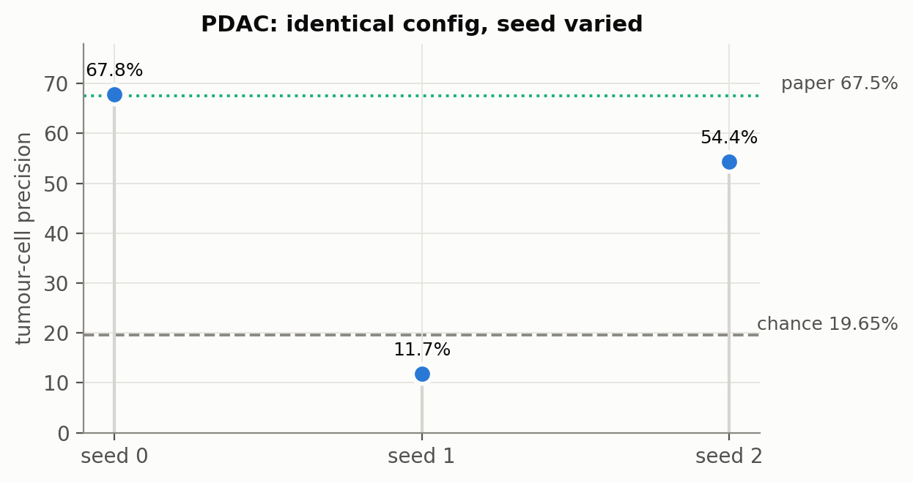
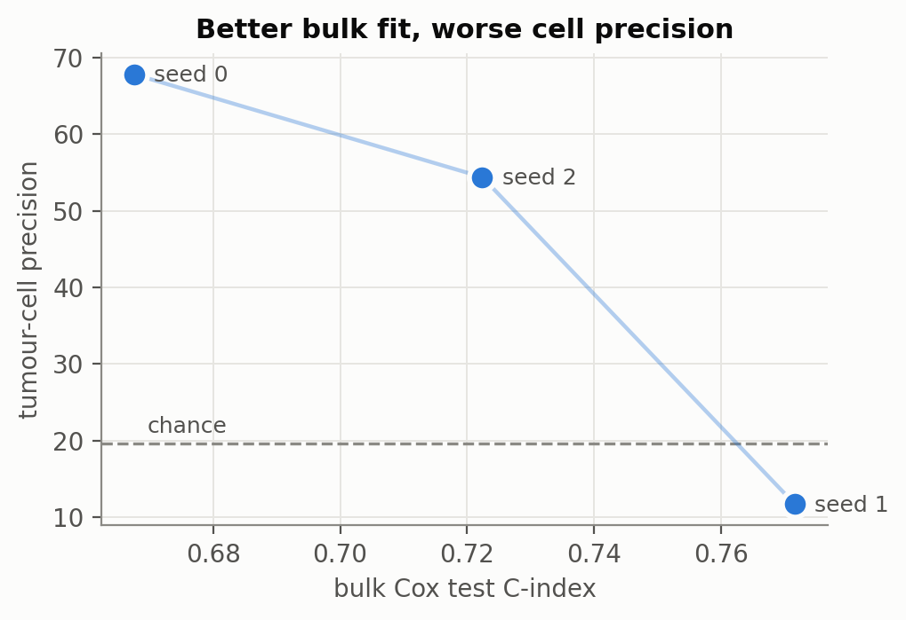
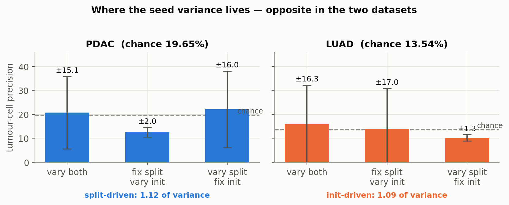
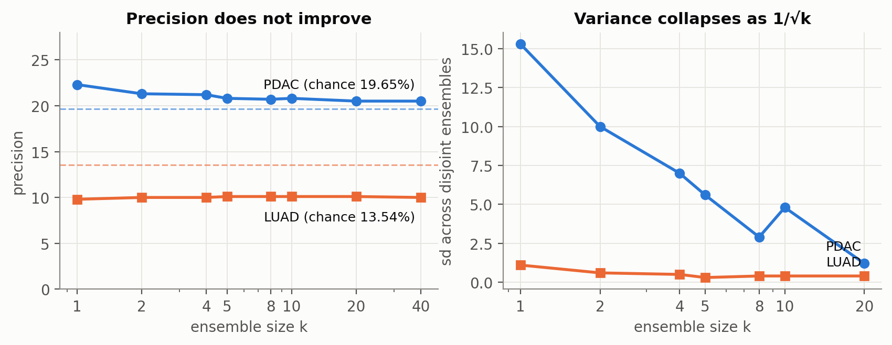
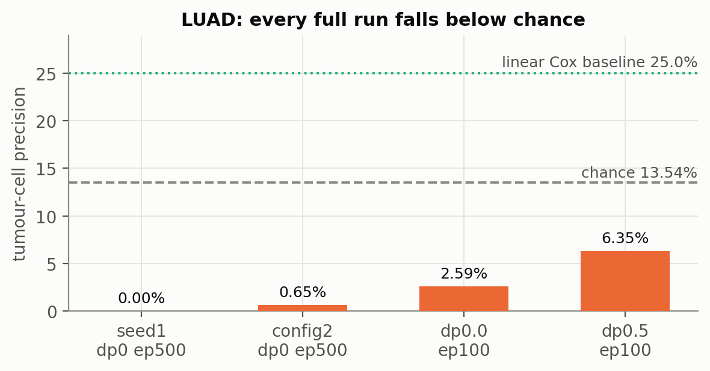
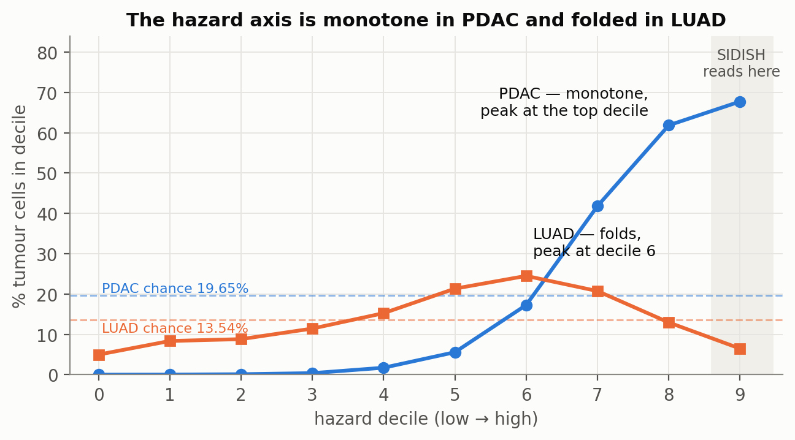
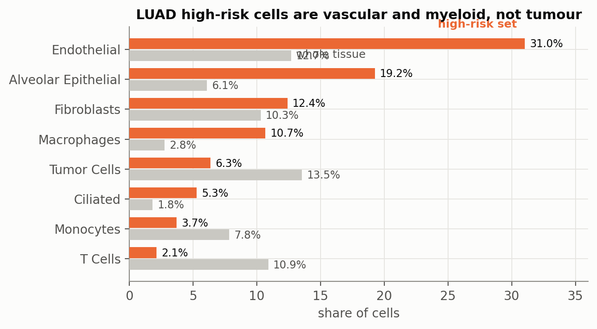
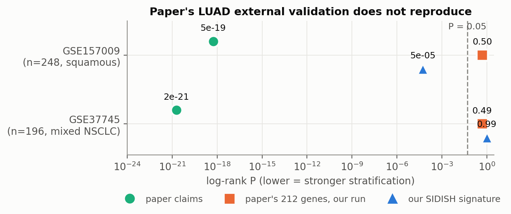

# SIDISH — results to date

**Author:** Shrey Mehta · **Date:** 22 September 2026
**Reference:** Jolasun et al., *SIDISH integrates single-cell and bulk transcriptomics to identify high-risk cells and guide precision therapeutics through in silico perturbation*, Nature Communications 16:11271 (2025).

---

> **Update, 30 September — supersedes §4 and summary point 2.** With six full-pipeline seeds, ensembling **does** stabilise PDAC: rank-averaging all six runs' per-cell hazards gives **66.8%** (AUROC 0.906), matching the paper's 67.5% even with the collapsed seed included. Every 5-run sub-ensemble lands at 60.1–72.0%. The "converges to chance" result in §4 came from frozen-trunk ensembles, which under-estimate the full pipeline ~2.4×, because trunk and head co-adapt over the 5 iterations. Separately, under-fitting the Cox head does *not* help (67.8% → 49.5% / 40.0%). Full details: `report/MECHANISM_AND_ROADMAP.md` §3.

> **Update, 6 October.** Paper Fig 6/7 reproduced on PDAC Xenium against Scissor/scAB/DEGAS: SIDISH wins only under the paper's in-sample protocol; on held-out survival tests it ties or loses (bulk-only Cox markers beat it), survival guidance does not improve the embedding, but SIDISH is uniquely strong at cell-level tumour localisation (AUROC 0.87 vs ≤0.57). See §6A.

## Summary

Four results, in descending order of confidence:

1. **The paper's PDAC spatial result reproduces at one seed (67.8% vs 67.5%) but is not stable.** Across three seeds of the identical configuration, tumour-cell precision spans **11.7% – 67.8%**, with one run **below chance**.
2. **The instability is located.** For PDAC, ~98% of it comes from *which patients land in the train/test split*, not from weight initialisation, the VAE, or the iterative loop. Averaging over splits removes the variance and the performance with it — converging to **23.2% ± 0.7 against 19.65% chance**.
3. **SIDISH does not work on spatial LUAD.** All four full runs fall below chance; a trivial linear Cox baseline (25.0%) outperforms it. The mechanism is identified: the hazard axis is non-monotone in tumour identity.
4. **The paper's LUAD external validation does not reproduce, and one of its two validation cohorts is squamous carcinoma, not adenocarcinoma.**

---

## 1. What was built

| Component | Detail |
|---|---|
| PDAC arm | 10x Xenium, **190,273 cells × 474 genes** — the paper's own Fig. 5 dataset (they report 190,965) |
| LUAD arm | 10x Xenium Prime 5K, **275,556 cells × 5001 genes** → 2,000 HVGs; full tumour microenvironment, 20 cell types |
| Bulk | TCGA-PAAD (173 patients) and TCGA-LUAD (503 patients, 181 events) via GDC with `expand=follow_ups` |
| LUAD cell types | 32 graph clusters → 20 types, malignancy assigned by **inferCNV-style evidence** (tumour clusters CNV sd 0.053–0.056 vs immune 0.008–0.016; chr9/13/18/19 loss, chr16/21 gain). Tumour = 13.51% |
| External validation | GSE157009 (n=249) and GSE37745 (n=196), GPL570, with probe→symbol collapse and a 1,000-permutation null |

`SIDISH/` was kept **bit-identical** throughout — it is the reference codebase behind the 67.8% PDAC number. All instrumentation lives in separate scripts.

---

## 2. PDAC: the reproduction, and its collapse

At seed 0 the pipeline returns **67.8%** tumour-cell precision against the paper's 67.5% — a clean reproduction of the paper's only spatial arm.

Re-running the *same configuration* with only the seed changed:

| seed | precision | lift | bulk test C-index |
|---|---|---|---|
| 0 | 67.80% | 3.45× | 0.6676 |
| 2 | 54.39% | 2.77× | 0.7224 |
| 1 | **11.74%** | **0.60×** | 0.7716 |

mean 44.6% ± 29.3, chance 19.65%

Seed 1 lands **below chance**. So 67.8% — and by extension the paper's 67.5% — is a top-of-distribution draw rather than the method's typical behaviour.

### The result cannot be selected for

Bulk C-index and cell precision are **inversely** related, monotonically across all three seeds and across all four LUAD runs (7 points, two datasets, same direction). The only honest model-selection signal available — bulk survival fit — picks the *worst* cell-level result.

This matters for how the number may be quoted. Reaching 67.8% requires selecting the seed using tumour-cell labels, i.e. the reported metric itself. In the paper's own LUAD and BRCA arms no such labels exist, so the selection rule is unavailable in the intended use case.

---

## 3. Where the variance comes from

Three controlled arms, 20 draws each, frozen trunk:

| | PDAC | LUAD |
|---|---|---|
| split-driven share | **1.12** | 0.01 |
| init-driven share | 0.02 | **1.09** |
| cell-score agreement across seeds | ρ = **+0.727** | ρ = **−0.013** |

**PDAC:** fix the split and 20 initialisations give 12.5% ± 2.0 with bulk CI 0.730 ± 0.004 — near-deterministic. Vary the split and the full 5–70% range returns. 138 of 173 patients cannot identify a direction in 128-dimensional feature space; swapping ~35 patients rotates the solution.

Notably the seeds largely *agree* on the overall cell ranking (ρ = 0.727). The disagreement is concentrated in the extreme tail — precisely the top 10% that the Weibull cutoff reads.

**LUAD:** the mirror image. Seeds produce mutually **uncorrelated** rankings (some anti-correlated at −0.786), so there is no shared direction at all.

> ⚠️ **Caveat:** the LUAD arm ran at 10 Cox epochs (sweep-selected) against PDAC's 500. At 10 epochs the head barely moves off its initialisation, so "init-dominated" may be an artifact of under-training. A matched 500-epoch rerun is in progress; this contrast should not be stated until it returns.

---

## 4. Ensembling stabilises, but does not rescue

If the split is the variance, averaging over splits should fix it. 40 heads, disjoint sub-ensembles so the *reproducibility of the ensemble itself* is measured:

| k | PDAC z-avg | PDAC sd | PDAC rank-avg | LUAD |
|---|---|---|---|---|
| 1 | 22.3% | 15.3 | 22.2% | 9.8% |
| 8 | 20.7% | 2.9 | 23.0% | 10.1% |
| 20 | 20.5% | **1.2** | 23.2% | 10.1% |
| 40 | 20.5% | — | **23.2%** | 10.0% |

Variance collapses cleanly as 1/√k. **Precision does not move.** All four ensemble operators tested (z-average, rank-average, consensus membership, Weibull vs plain quantile) land at lift **1.04–1.18×**.

So the *reproducible* component of the hazard direction carries almost no tumour information; the 67.8% came from the split-specific component, which is by definition noise.

> ⚠️ **Caveat:** this uses one frozen trunk (config2's, co-adapted to seed 0) with swapped heads. In the real pipeline trunk and head co-adapt over 5 iterations, and the full-pipeline 3-seed mean (44.6%) sits above the frozen-trunk mean (22.3%). With n=3 the standard error is ~17, so this is unresolved. Five more full-pipeline seeds are running.

---

## 5. LUAD: a negative result with a mechanism

Every full run falls below the 13.54% chance rate, and a linear Cox projection baseline reaches 25.0%.

### Why: the hazard axis folds

PDAC's hazard axis is **monotone** in tumour content across all ten deciles (0.01% → 67.74%), peaking exactly where SIDISH cuts. LUAD's **folds** — tumour peaks at decile 6 (24.6%, lift 1.82×) and collapses to 6.3% at decile 9, the one place the Weibull 0.90 cutoff reads.

The signal exists; the pipeline reads it off at the worst point on the curve.

### What the model actually found

High-risk cells are vascular and myeloid, with tumour *depleted* (0.47× enrichment) and lymphocytes strongly excluded (0.03–0.19×). Module scores confirm it: angiogenesis **2.50×**, myeloid activation **2.34×**, hypoxia/glycolysis 1.37×, tumour identity 1.18×. Differential expression independently agrees — the top genes are SELE, SELP, THBD, NOTCH4, EGFL7, TEK, PECAM1, ROBO4, CLDN5, CD93.

This is a coherent, real biological programme. It is simply not the tumour-identity axis. Within tumour cells the hypoxia ratio is **1.04** — flat — so the model cannot rank malignant cells by state, which is what the paper's LUAD arm claims to do.

### Eliminated by measurement

λ_env (trained ratio 1.23× — exonerated) · bulk/cell domain mismatch (log1p rescoring, no gain) · Cox overfitting as sole cause (PDAC has an identical train/test gap) · trunk quality (LUAD latent separates tumour at **AUC 0.986**, better than PDAC's 0.954) · under-training (VAE plateaus at epoch ~111 of 225) · input scaling · module-based gene selection · split-ensembling.

---

## 6. Paper-level findings

### 6a. The LUAD external validation does not reproduce

Using the paper's **exact 212 marker genes** (Supplementary Data), their cohorts and their sample counts:

| cohort | paper reports | our run, their genes |
|---|---|---|
| GSE157009 (n=248) | 5.40e-19 | **P = 0.504** |
| GSE37745 (n=196) | 1.89e-21 | **P = 0.489** |
| GSE37745 adeno (n=106) | — | P = 0.627 |

The pipeline is demonstrably functional: our own signature reaches **P = 5.24e-05** on GSE157009 through identical code (empirical p = 0.001 against 1,000 random same-size gene sets), and random sets clear P<0.05 only 1.6–3.7% of the time — calibrated and slightly conservative.

> ⚠️ **Caveat:** the paper does not state its scoring rule ("stratified patients based on marker gene expression levels"). We used mean z-score across genes, median split, log-rank. A different rule can move a P-value — not by 19–21 orders of magnitude. For scale, P = 1.89e-21 at n=196 with 145 events requires log-rank χ² ≈ 90, near the arithmetic ceiling for a median split.

### 6b. One "LUAD" validation cohort is squamous

GSE157009's series title is *"Multi-institutional prospective validation of prognostic mRNA signatures in early stage **squamous** lung cancer (Alliance) [cohort I]"*. All 249 samples carry `diagnosis: Squamous Cell Carcinoma of Lung` — zero adenocarcinoma. Supplementary Data sheet "4. Independant Datasets" lists it at 249 samples, i.e. the whole series, and the SI never mentions histology.

The paper describes it as one of "two independent **LUAD** bulk datasets". The second, GSE37745, is mixed NSCLC (adeno / squamous / large) used in full rather than as its adeno subset.

Interestingly, **our** signature *is* strongly prognostic in that squamous cohort (P = 5.24e-05) and not in true LUAD (P = 0.246) — consistent with its angiogenic/myeloid character.

---

## 6A. Paper Fig 6 / Fig 7 reproduced on PDAC Xenium, and LUAD high-risk spatial check (1–2 October)

**Setup.** Scissor, scAB and DEGAS (official code, isolated `rbench` conda env) vs SIDISH, 6 replicates. Replicate r = random 10k-cell subsample (Scissor/scAB build dense cells×cells matrices) paired with SIDISH full-pipeline seed r; all methods scored on the same cells. Each tool uses its own published high-risk rule. scAB has 5/6 replicates (rep 1 exceeded a 3 h cap). Scoring follows the paper's Methods: Wilcoxon markers (log2FC>1, BH<0.05) → Cox on markers in TCGA-PAAD → median split / C-index. Code: `fig6_pdac/`, `fig7_pdac/`. SIDISH/ unmodified.

### Fig 6 analogue — medians

| metric | SIDISH | Scissor | scAB | DEGAS |
|---|---|---|---|---|
| KM −log10 P, TCGA in-sample *(paper protocol)* | **11.6** | 4.9 | 7.4 | 4.1 |
| C-index, in-sample *(paper protocol)* | **0.78** | 0.70 | 0.73 | 0.63 |
| KM −log10 P, 5-fold CV | 2.46 | 1.96 | 1.24 | 2.38 |
| C-index, 5-fold CV | **0.619** | 0.617 | 0.574 | 0.592 |
| KM −log10 P, external GSE224564 | 0.25 | 1.65 | 0.21 | **2.10** |
| tumour precision of high-risk cells (chance ≈ 19.5%) | **56.6%** | 37.3% | 23.4% | 16.9% |
| per-cell tumour AUROC | **0.87** | 0.54 | 0.57 | 0.48 |
| # marker genes | 74 | 28 | 58 | 9 |

### Fig 7 analogue — ablations

| median | SIDISH | bulk-only markers (univariate Cox HR>1, p<0.05) |
|---|---|---|
| C-index in-sample / 5-fold CV | 0.78 / 0.62 | **0.85 / 0.66** |
| KM −log10 P external GSE224564 | 0.25 | **2.02** |

| median (k-means ×20 inits vs annotated cell types) | SIDISH latent (6 seeds) | simple VAE = SIDISH phase-1 only (2 seeds) |
|---|---|---|
| ARI / NMI / completeness / FMI / silhouette | 0.280 / 0.429 / 0.409 / 0.342 / 0.118 | 0.278 / 0.432 / 0.411 / 0.340 / 0.120 |

ARI/FMI show P=0.024 only because k-means inits were counted as samples; at the seed level (6 vs 2) the latents are indistinguishable. Fig 7k–m (per-iteration) not reproducible without modifying SIDISH (no per-iteration outputs saved).

### Verdict: is SIDISH better or worse?

Two-sided Mann–Whitney at the replicate level (6 SIDISH reps vs 6 Scissor / 5 scAB / 6 DEGAS / 6 bulk-only).
✅ significantly better · ❌ significantly worse · ▲ ahead, not significant · ▼ behind, not significant · = no difference.

| metric | vs Scissor | vs scAB | vs DEGAS | vs bulk-only Cox |
|---|---|---|---|---|
| KM, TCGA in-sample *(paper)* | ✅ | ▲ | ✅ | ❌ |
| C-index, in-sample *(paper)* | ✅ | ▲ | ✅ | ❌ |
| KM, 5-fold CV | ▲ | ✅ | ▲ | ▼ |
| C-index, 5-fold CV | = | ▲ | ▲ | ❌ |
| KM, external GSE224564 | ❌ | = | ❌ | ❌ |
| tumour precision | ▲ | ▲ | ▲ | — |
| tumour AUROC | ✅ | ▲ | ✅ | — |

Embedding vs simple VAE: ARI / NMI / silhouette all **=** (2 VAE seeds cannot reach significance; medians differ by ≤0.003).
"▲" against scAB and on tumour precision is driven by SIDISH seed 1 (11% precision); dropping that seed makes them significant, but that is post-hoc.

**Score:** 7 significant wins, 6 significant losses, 13 ahead/behind-but-not-significant or tied. Wins are in-sample survival (paper protocol) and cell-level tumour AUROC; losses are all held-out survival (external cohort, bulk-only baseline).

### Reading

1. The paper's Fig 6 ranking reproduces **under its own protocol**, but that protocol scores markers in-sample on the cohort SIDISH trained on, and rewards more markers (SIDISH yields the most).
2. Held-out survival evidence does not favour SIDISH: it ties Scissor under CV and is worst on the external cohort; plain bulk Cox markers beat SIDISH on every survival metric (contradicts Fig 7a–e).
3. Survival guidance does not improve the embedding (contradicts Fig 7f–j, +35% ARI claimed).
4. **SIDISH's distinctive strength is cell-level tumour localisation** (AUROC 0.87 vs ≤0.57 for all competitors) — a metric only spatial ground truth allows and the paper never reports.

Caveats: Xenium 474-gene panel, not the paper's scRNA-seq; 10k-cell subsamples; seed 1 still collapses (11% precision).

### Comparison with the paper's own values (original non-spatial SIDISH, PDAC scRNA-seq)

Paper values are medians from its Source Data file (`LUAD_validation/MOESM14_ESM.zip`, Fig 6c/f/i, Fig 7c/e/f–j). Paper = scRNA-seq PRJCA001063, full transcriptome, non-spatial SIDISH, 10–50 seeds. Ours = Xenium 474-gene panel, spatial SIDISH, 6 seeds.

| metric (PDAC) | | SIDISH | Scissor | scAB | DEGAS | bulk-only |
|---|---|---|---|---|---|---|
| KM −log10 P, TCGA | paper (6c) | **83.1** | 30.2 | 50.2 | 11.3 | 3.8 (7c) |
| | ours, in-sample | **11.6** | 4.9 | 7.4 | 4.1 | 19.6 |
| C-index, TCGA | paper (6f, 7e) | **0.609** | 0.541 | 0.541 | 0.559 | 0.552 |
| | ours, 5-fold CV | **0.619** | 0.617 | 0.574 | 0.592 | 0.657 |
| | ours, in-sample | **0.78** | 0.70 | 0.73 | 0.63 | 0.85 |
| PDAC gene-set score in high-risk cells | paper (6i) | **0.195** | 0.142 | 0.005 | −0.020 | — |
| | ours | 0.498 | **0.602** | 0.000 | −0.040 | — |

| embedding (PDAC), median | paper SIDISH | paper simple VAE | ours SIDISH | ours simple VAE |
|---|---|---|---|---|
| ARI | **0.849** | 0.753 | 0.280 | 0.278 |
| NMI | **0.852** | 0.827 | 0.429 | 0.432 |
| completeness | **0.910** | 0.867 | 0.409 | 0.411 |
| FMI | **0.851** | 0.792 | 0.342 | 0.340 |
| silhouette | 0.140 | **0.153** | 0.118 | 0.120 |

**What matches:**
- KM ranking among tools is identical: SIDISH > scAB > Scissor > DEGAS (paper and ours).
- SIDISH's C-index matches: paper 0.609, ours 0.619 under CV. The paper's C-index looks out-of-sample (some seeds < 0.5), so our CV column is the like-for-like one.
- Gene-set panel: SIDISH and Scissor on top, scAB and DEGAS near zero, in both.
- The simple VAE has higher silhouette than SIDISH, in both.

**What does not match:**
- The competitors do better for us. Under CV, Scissor ties SIDISH (0.617 vs 0.619), whereas in the paper SIDISH leads by about 0.07.
- Bulk-only: the paper has SIDISH beating it (C-index 0.609 vs 0.552, P 4e-18 vs 1e-4). We find the reverse (0.619 vs 0.657).
- Embedding: the paper shows a +0.10 ARI gain from survival guidance. We find none.
- Absolute KM and ARI values are much lower for us. That is expected with 474 genes instead of the whole transcriptome, and with Xenium cell types instead of scRNA-seq clusters, so compare rankings, not raw numbers.

### LUAD high-risk cells: near tumour? (best run `luad_dp0.5_ep100`)

Type-matched comparison (high-risk vs background cells of the same type). Figures: `report/figs/luad_highrisk/`.

| type | share of high-risk | median dist. to tumour, high vs bg | P(high closer) | state |
|---|---|---|---|---|
| Endothelial | 31% | 188 vs 191 µm | 0.50 | inflamed venule (SELE/SELP 1.9×), higher *away* from tumour |
| Alveolar epithelial | 19% | 235 vs 224 µm | 0.48 | normal AT1/AT2 |
| **Fibroblasts** | 12% | **25 vs 147 µm** | **0.73** | **CAF (POSTN/FAP/COL11A1 5.1×)** |
| Macrophages | 11% | 43 vs 33 µm | 0.42 | resident alveolar, not TAM |

Hypothesis partly supported: high-risk **CAFs** sit at the tumour border (genuine pro-progression population). Endothelial/alveolar/macrophage calls are the **normal alveolar unit** in tumour-free lung — a composition artefact, consistent with composition explaining 98.6% of between-patient feature variance.

---

## 7. Status of the items that were in progress on 22 September

| | status |
|---|---|
| PDAC full-pipeline seeds | **done** for seeds 3, 4, 5 (6 seeds total). See `MECHANISM_AND_ROADMAP.md` §3.1 |
| Full-pipeline split ensembling | **done**: 6-run rank-average gives 66.8% (AUROC 0.906). See `MECHANISM_AND_ROADMAP.md` §3.4 |
| LUAD variance decomposition at matched 500 epochs | not reported in this snapshot; the §3 PDAC/LUAD contrast stays unclaimed until it is |
| BRCA + TNBC decompositions | not started; both datasets on the server, ~2 h each on a frozen trunk |

---

## 8. Notes on method

- **Permutation nulls throughout.** Every survival claim is accompanied by 1,000 random same-size gene sets, because a coherent expression module can split a bulk cohort by itself. The nulls came back calibrated (1.6–3.7% at α=0.05), which is what makes both the positive and negative KM readings trustworthy.
- **Disjoint sub-ensembles.** Ensemble sizes are evaluated on non-overlapping groups of heads, so the reported sd reflects reproducibility rather than shared membership.
- **Frozen-trunk sweeps.** Precomputing trunk activations lets a Cox-head variant be trained and all cells scored in seconds rather than the ~20 h a full run costs — this is what made 40-seed distributions affordable.
- **Selection discipline.** Several settings would make results look better (scoring at decile 6 gives 24.6%; L1-to-bulk-magnitude scoring gives 27.9%). All were found by inspecting tumour labels, so none are usable. Eight distinct LUAD interventions have now been tried; that count belongs in any eventual positive report.

---

## Appendix — where things live

| Path | Contents |
|---|---|
| `outputs/<run>/summary.json` | precision, recall, lift, C-index, runtime per run |
| `outputs/<run>/cell_labels.csv` | per-cell `celltype_major` + `SIDISH` label |
| `outputs/<run>/{vae_transfer,deepCox}` | checkpoints — any run can be re-scored without retraining |
| `outputs/sweep_head.csv`, `sweep_lowepoch.csv` | frozen-trunk seed and hyperparameter sweeps |
| `outputs/ensemble_cellscores*.npy` | 40 × n_cells hazard matrices for ensembling |
| `LUAD_validation/` | GEO series matrices, GPL570 annotation, paper's 212 markers |
| `why_seed.py`, `ensemble_splits.py`, `ensemble_variants.py` | variance decomposition and ensembling |
| `report/make_figs.py` | regenerates every figure in this document |

`adata_SIDISH.h5ad` files were deleted after label extraction (20.5 GB); latents are regenerable from `vae_transfer` via `getEmbedding`.
